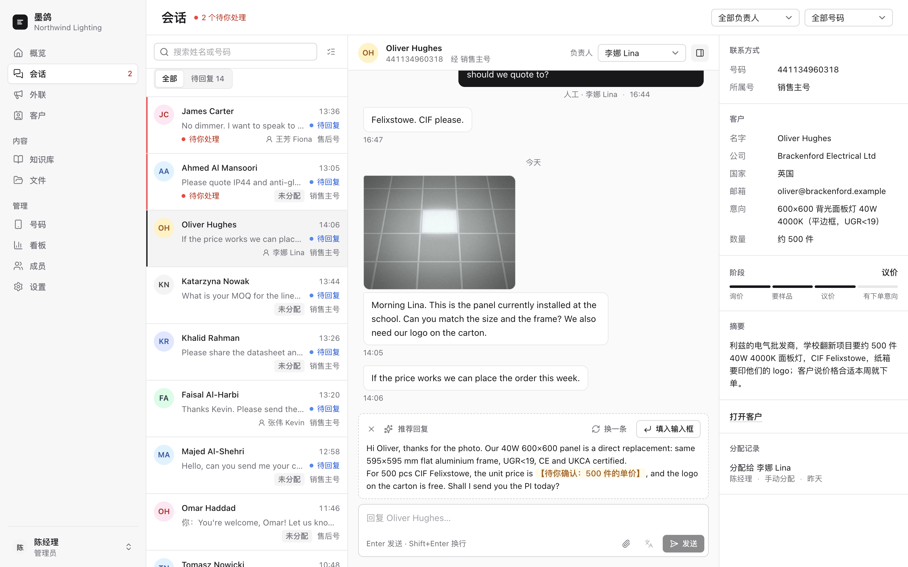
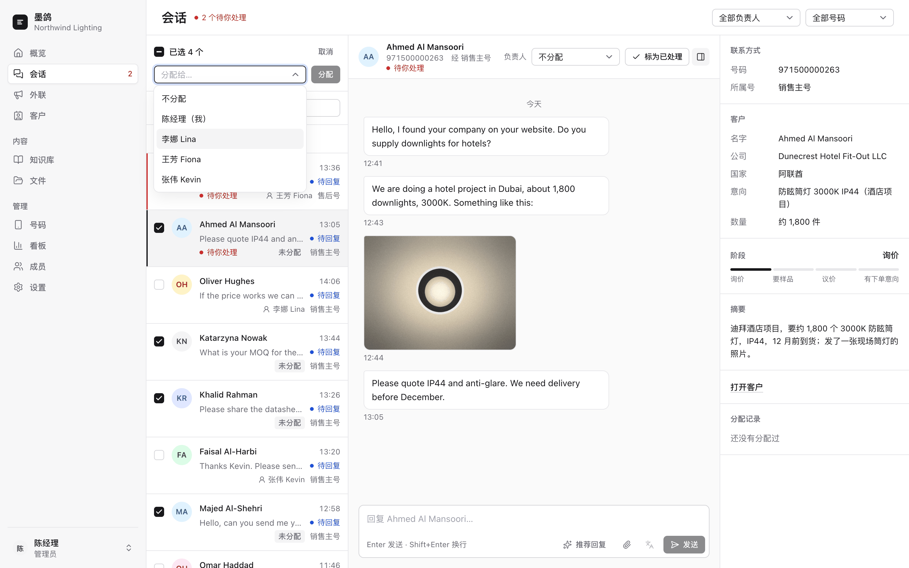
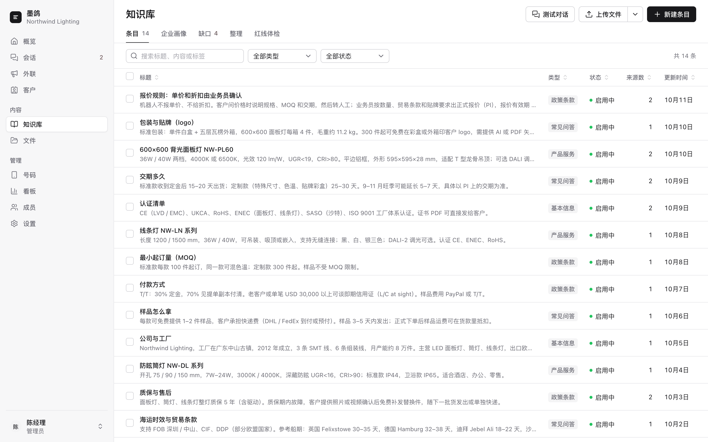
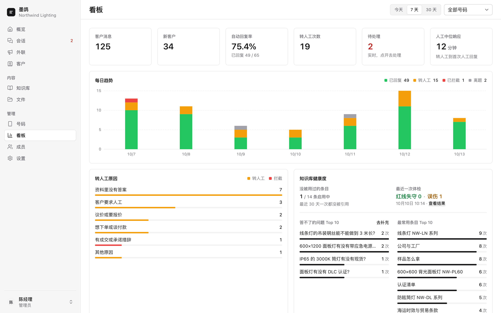

<div align="center">

<picture>
  <source media="(prefers-color-scheme: dark)" srcset="assets/logo-dark.svg">
  
</picture>

# 墨鸽 Inkdove

**外贸团队的 WhatsApp 工作台：公司号统一对外，客户分给业务员，需要时一键让 AI 按知识库起草回复，人来发。**

[](https://github.com/Bowen1314/inkdove/releases/latest)
[](LICENSE)
[](https://github.com/Bowen1314/inkdove/pkgs/container/inkdove)
[](https://nodejs.org/)
[](https://github.com/Bowen1314/inkdove/actions/workflows/release.yml)

中文 | [English](README_EN.md)

[快速开始](#快速开始) · [功能](#功能) · [截图](#截图) · [文档](#文档)

</div>

<p align="center">
  
</p>

## ⚠️ 使用前须知

- **扫码接入有封号风险。** 扫码（WAHA）走的是 WhatsApp 网页版的非官方协议，号码可能被限制或封禁。重要的号建议用 Meta 官方 Cloud API，见[两种接入方式的区别和风险](docs/channels-and-security.md#两种接入方式的区别和风险)。
- **不要拿来群发骚扰。** 不要给没同意过的人发营销消息，遵守 WhatsApp 的条款和当地法律。
- **AI 起草的内容由发送人负责。** AI 可能写错价格、交期和承诺，发出前请核对。

## 适合谁，不适合谁

**适合：**

- 外贸团队几个人共用公司的 WhatsApp 号对外，不想用各自的私人号；
- 客户要留在公司：业务员离职时，他的客户一键转交给别人，聊天记录都在；
- 想让新人也按公司的产品资料、价格和说法回复客户；
- 老板想看到所有聊天，随时能接手。

**不适合：**

- 群发营销、获客拉新：外联每个号码只发一条开场消息，不跟进，每个号每天还有上限；
- 想让 AI 全自动谈单：折扣、报价、下单这些 AI 不会替你答应，要人拍板；
- 一个人用一个号，也不需要知识库：直接用手机或电脑上的 WhatsApp 就够了。

## 功能

- **公司号统一对外，客户分给业务员。** 业务员不用自己的 WhatsApp，都在后台用公司的号聊。管理员把客户分给业务员（可以多选批量分），业务员只看得到分给自己的；离职时一键转交，客户始终留在公司。客户发来的图片、视频、语音和文件在会话里直接看。[详细](docs/features.md#多人账号按客户分配)
- **需要时一键让 AI 起草，人来发。** 在会话页点「推荐回复」，AI 读上下文、按知识库起草一条，要人拍板的地方（折扣、交期、按量报价……）写成【待你确认：…】；不满意就点「换一条」。业务员自己发过话以后再点，推荐会接着往下说（比如兑现「我来讲一下怎么注册」）。公司话术和每个人的「我的资料」管说话的口气和署名。[详细](docs/features.md#推荐回复和话术)
- **知识库。** 上传 PDF、Word、Excel、PPT 或网址，AI 整理成产品、价格、政策、FAQ 条目；缺的资料列成缺口清单，补上就变成条目；知识库很大时可以开「向量检索」，客户换种语言、换个说法问也找得到。可以在后台跟机器人「测试对话」，还能一键「红线体检」。[详细](docs/features.md#知识库)
- **产品资料库，一键发文件。** 上传产品目录、价目表、规格书、图片，在会话里直接发给客户；推荐回复也会建议该发哪个文件。[详细](docs/features.md#产品资料库)
- **自动回复和转人工（可选）。** 适合客服类的固定问答：机器人只按知识库回答，碰到打折、下单、问是不是机器人这类问题不回，转给人工，并通过 WhatsApp 或邮件通知你。回复前要过四层把关。[详细](docs/features.md#转人工自动回复模式) · [安全设计](docs/channels-and-security.md#安全设计)
- **客户线索。** 自动从聊天里整理出客户的名字、公司、国家、意向产品、数量和阶段，能搜、能改、能导出 CSV。[详细](docs/features.md#客户线索)
- **主动外联。** 上传已经同意被联系的客户号码，每人发一条开场消息；按每天上限、随机间隔、对方当地时间慢慢发，不跟进。[详细](docs/features.md#主动外联)
- **看板。** 管理员看消息量、新客户、转人工原因和响应时间、每个成员处理了多少、模型花了多少钱、外联效果。[详细](docs/features.md#数据看板管理员)
- **多号、两种接入、在线更新。** 一套部署接多个号，扫码（WAHA）或 Meta 官方 Cloud API 都行，每个号可以单独走代理。出了新版本，在网页上点一下就能更新，也可以预约到夜里自动更新。[接入和代理](docs/channels-and-security.md) · [在线更新](docs/online-update.md)

每个功能的完整说明见 [docs/features.md](docs/features.md)。

## 截图

<table>
  <tr>
    <td width="50%" valign="top">
      <br>
      <sub>会话：点「推荐回复」，AI 起草一条，【待你确认】的地方高亮，改好再发</sub>
    </td>
    <td width="50%" valign="top">
      <br>
      <sub>按客户分配：多选会话，一次分给业务员</sub>
    </td>
  </tr>
  <tr>
    <td width="50%" valign="top">
      <br>
      <sub>知识库：上传的资料整理成一条条产品、价格、政策、FAQ</sub>
    </td>
    <td width="50%" valign="top">
      <br>
      <sub>看板：消息量、转人工原因、响应时间、模型花费</sub>
    </td>
  </tr>
</table>

## 快速开始

推荐用官方镜像 + docker compose。自己编译镜像、反代这些细节见 [docs/deploy.md](docs/deploy.md)。

### 前置条件

- 一台装了 Docker 和 Docker Compose v2 的 Linux 服务器或 Mac，amd64、arm64 都行。三个容器的内存上限加起来约 1.3GB。
- 一个大模型的 API key：OpenAI、Anthropic、Gemini 三种接口格式都行，兼容 OpenAI 接口的也可以。
- 一个 WhatsApp 号：扫码接入要一部装了 WhatsApp 的手机；用 Meta 官方 Cloud API 要 Meta 开发者账号和公网 HTTPS 地址。

### 步骤

1. 下载代码，复制配置文件：

   ```bash
   git clone https://github.com/Bowen1314/inkdove.git
   cd inkdove
   cp .env.example .env
   ```

2. 编辑 `.env`，至少填这 6 项：

   | 变量 | 填什么 |
   |---|---|
   | `INKDOVE_ADMIN_EMAIL` | 第一个管理员的邮箱，用来登录后台 |
   | `INKDOVE_ADMIN_PASSWORD` | 管理员密码，至少 12 位 |
   | `INKDOVE_SESSION_SECRET` | 随机串 |
   | `INKDOVE_WAHA_WEBHOOK_SECRET` | 随机串 |
   | `INKDOVE_WAHA_API_KEY` | 随机串 |
   | `INKDOVE_UPDATER_TOKEN` | 随机串，网页上「立即更新」用。不要在线更新的话见[在线更新](docs/online-update.md) |

   随机串用这条命令生成，每项单独生成一个：

   ```bash
   openssl rand -hex 32
   ```

   大模型的 key 不用写在这里，登录后在网页上填。其他变量见[环境变量](docs/deploy.md#环境变量)。

3. 拉镜像，启动：

   ```bash
   docker compose pull
   docker compose up -d
   ```

4. 打开 `http://127.0.0.1:8794`，用 `.env` 里的管理员邮箱和密码登录。后台只监听本机；装在远程服务器上时，先用 `ssh -L 8794:127.0.0.1:8794 <你的服务器>` 连过去再打开，或者按下面「对外访问」配好 HTTPS。

### 登录后先做这 5 步

1. **设置 → AI 模型**：填 LLM 的接口格式（openai / anthropic / gemini）、地址、key 和模型，点「测试连接」。
2. **文件 → 知识库资料**：上传资料或填网址，点「开始整理」，等它生成条目。
3. **知识库 → 测试对话**：问几个客户常问的问题，看回答对不对。
4. **号码 → 添加号码**：
   - 扫码号：点「开始扫码连接」，用手机 WhatsApp 的「已关联的设备」扫二维码。不方便扫码时（比如只有这一部手机），把「关联方式」切到「手机号配对码」，填这个号的手机号（带国家码）获取 8 位配对码，在手机上「关联新设备 → 改用手机号码关联」里输入，配对码约 2 分钟内有效；
   - Meta 号：填 phone number id、verify token、access token、app secret，把页面上显示的 webhook 地址（`<INKDOVE_PUBLIC_BASE_URL>/webhooks/meta/<号的 id>`）填进 Meta 后台，订阅 `messages`。
5. 在号详情里选**回复方式**：新建的号默认是「人工回复」，客户来消息只存下来，不调用 AI；业务员需要时在会话页点「推荐回复」，AI 按知识库起草一条，改好再发。想让机器人直接回客户就选「自动回复」，并配好「拿不准时通知我」。要发邮件通知的话，先在**设置 → 发信方式**里配 SMTP 或 Resend。公司话术在**设置 → 推荐回复**里写。

有业务员的话：**成员 → 邀请成员**，给他分能用的号，再在**会话**页把客户分给他。

### 对外访问（HTTPS）

后台只监听本机的 `127.0.0.1:8794`。要让业务员在外面用、或者接 Meta Cloud API，用 nginx 之类反代成 HTTPS，并在 `.env` 里设 `INKDOVE_PUBLIC_BASE_URL=https://kb.example.com`、`INKDOVE_COOKIE_SECURE=1`，再执行一次 `docker compose up -d`。Meta 回调必须是公网 HTTPS 地址。nginx 配置示例见 [docs/deploy.md](docs/deploy.md#对外访问https-反代示例)。

### 升级

- **网页上**：有新版本时，管理员在侧栏底部会看到提示，点开后点「立即更新」，或者点「预约更新」选个时间（比如夜里）到点自动更新。后台约 1 分钟打不开，好了自动刷新。更新前会先备份数据库。
- **命令行**：在 `docker-compose.yml` 所在目录执行：

  ```bash
  docker compose pull
  docker compose up -d
  ```

跨版本时要注意的变化（比如 v0.3.1 起推荐回复改为手动）见 [docs/upgrade.md](docs/upgrade.md)；钉版本号、回滚见 [docs/online-update.md](docs/online-update.md)。

### 常用命令

在 `docker-compose.yml` 所在目录执行：

```bash
docker compose ps                  # 看容器在不在跑
docker compose logs -f inkdove     # 看应用日志（WhatsApp 连接的日志把 inkdove 换成 waha）
docker compose restart inkdove     # 重启应用
docker compose down                # 全部停掉（数据还在）
```

备份：数据库和上传的文件都在 `./data`，扫码号的登录态在 `./waha-sessions`，密钥在 `.env`。先停应用再打包，Linux 上文件是容器里的 root 建的，要加 `sudo`：

```bash
docker compose stop inkdove
sudo tar czf inkdove-backup-$(date +%Y%m%d).tar.gz data waha-sessions .env
docker compose start inkdove
```

备份里有密钥（LLM key、Meta token 等），要像密码一样保管。

## 文档

- [部署和配置](docs/deploy.md)：自己编译镜像、容器和数据目录、HTTPS 反代示例、全部环境变量
- [升级说明](docs/upgrade.md)：跨版本时数据或行为的变化（从第一期升级、按客户分配、推荐回复）
- [在线更新](docs/online-update.md)：网页上一键更新怎么工作、安全、钉版本号、备份和回滚
- [两种接入方式、安全设计和代理](docs/channels-and-security.md)：扫码和 Meta 官方 API 的区别和风险、机器人回复的四层把关、代理中继
- [功能说明](docs/features.md)：每个功能的完整说明，以及实现细节和接口约定
- [开发](docs/development.md)：项目结构、本地开发和测试、发新版
- [偏离规格](docs/deviations.md)：开发中和 SPEC 不一致的地方
- [已核实的外部接口](docs/external-apis.md)：WAHA、Meta、Resend、SMTP、LLM 接口的依据和实测结果

## 许可证

Copyright © 2026 Inkdove contributors

从 v0.2.0 起采用 [GNU Affero General Public License v3.0](LICENSE)（AGPL-3.0-only）：

- 个人和公司都可以免费使用、修改、自己部署，包括用于商业经营；
- 分发修改后的版本，或者把修改后的版本部署成服务、让别人通过网络使用，都要以 AGPL-3.0 公开完整的修改后源代码；
- 后台「设置 → 版本」里有源代码链接，二次开发后请改成你自己的仓库地址。

v0.1.0 及更早的版本仍然是 MIT 协议。

想闭源商用、不想遵守 AGPL 的，可以另谈商业授权，请在 GitHub [开 Issue](https://github.com/Bowen1314/inkdove/issues) 联系。

<p align="center">觉得有用请点个 Star。</p>
